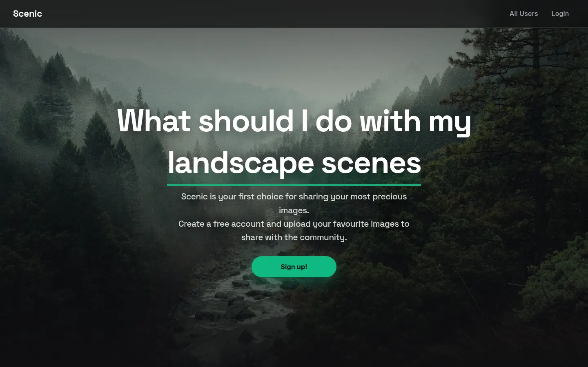

# Scenic

A full-stack MERN image-sharing app: create an account, post photos of places you love with their location, and browse what other members have shared.

- **Live app:** https://scenic-app.vercel.app
- **API:** https://scenic-api.vercel.app



Scenic was first built in November 2021 as a learning project and reworked in June 2026 to run serverless on Vercel, with a demo mode, keyless geocoding and an OpenStreetMap viewer.

## Features

- **Accounts:** sign up with a name, email, password (6 or more characters) and a profile image. Passwords are hashed with bcrypt and logins return a JSON Web Token that expires after one hour. The client keeps the session in `localStorage` and logs out automatically when the token expires.
- **Community:** an "All Users" page lists every member, and each member has a page of their scenes.
- **Scenes:** signed-in users add a scene with a title, description, location and a PNG or JPEG image (up to 3 MB). Images are stored as base64 in the MongoDB document, so uploads never touch the server's filesystem.
- **Edit and delete:** owners can edit a scene's title and description or delete it. The API checks ownership before any change.
- **Maps:** the location you type is turned into coordinates (Google Geocoding API when `GOOGLE_API_KEY` is set, otherwise Nominatim with Photon as a fallback), and "View on the Map" opens an OpenStreetMap embed.
- **Demo mode:** if no database is configured or it cannot be reached, read requests are answered from a built-in set of two users and three New Zealand scenes, and write requests return a 503 with an explanation.
- **Edge caching:** GET responses send `Cache-Control: s-maxage=1, stale-while-revalidate=599`, so the CDN can answer reads from cache while it refreshes in the background, which hides serverless cold starts.

## Tech stack

- **Client (`ScenicFront/`):** React 17, React Router 5, Create React App 3
- **API (`ScenicBack/`):** Node.js 18 or later, Express 4, Mongoose 5, multer, express-validator, bcryptjs, jsonwebtoken, axios
- **Database:** MongoDB (MongoDB Atlas in the live deployment)
- **Hosting:** both apps on Vercel; the API runs as a serverless function through `api/index.js` and the rewrite in `vercel.json`

## API

| Method | Path | Auth | Purpose |
| --- | --- | --- | --- |
| GET | `/` | | Health check |
| GET | `/api/users/users` | | List users (passwords excluded) |
| POST | `/api/users/signup` | | Create an account (multipart: `name`, `email`, `password`, `image`) |
| POST | `/api/users/login` | | Log in with `email` and `password`, returns `userId` and `token` |
| GET | `/api/scenes/:sceneId` | | Get one scene |
| GET | `/api/scenes/user/:userId` | | List a user's scenes |
| POST | `/api/scenes` | Bearer token | Create a scene (multipart: `title`, `description`, `address`, `image`) |
| PATCH | `/api/scenes/:sceneId` | Bearer token | Update `title` and `description` (owner only) |
| DELETE | `/api/scenes/:sceneId` | Bearer token | Delete a scene (owner only) |

## Running it locally

### Environment variables

API (`ScenicBack/.env`, see `ScenicBack/.env.example`):

- `DB_URL`: MongoDB connection string. Without it the API runs in read-only demo mode.
- `JWT_KEY`: secret used to sign and verify tokens. Needed for sign-up, login and any write.
- `GOOGLE_API_KEY`: optional. When set, Google geocodes addresses; otherwise Nominatim and Photon are used. Leave it empty (as in `.env.example`) unless you have a real key.
- `PORT`: optional, defaults to `5000`.
- `CORS_ORIGIN`: optional comma-separated list of browser origins allowed to call the API. Unset allows any origin.
- `SEED_PASSWORD`: optional, only read by the seeding script below.

Sign-up and login are rate-limited to 10 attempts per IP address every 15 minutes. On Vercel each running instance keeps its own count, so the limit slows guessing rather than capping it exactly.

Client:

- `REACT_APP_BACKEND_URL`: the API base URL including `/api`, for example `http://localhost:5000/api`.

### Database note

Creating and deleting scenes uses MongoDB transactions, which need a replica set. MongoDB Atlas works as is. A plain standalone local `mongod` will serve reads, sign-up, login and scene edits, but scene create and delete will fail unless it runs as a replica set.

### Start the API

```bash
cd ScenicBack
npm install
cp .env.example .env   # fill in DB_URL and JWT_KEY
npm start              # http://localhost:5000
```

To copy the demo users and scenes into a real database, run the seeding script from `ScenicBack`. It does not read `.env`, so pass the variables in the shell:

```bash
DB_URL=<connection-string> node util/seedAtlas.js
```

It skips users and scenes that already exist. If `SEED_PASSWORD` is not set, it generates a password for the seeded users and prints it.

### Start the client

```bash
cd ScenicFront
npm install
REACT_APP_BACKEND_URL=http://localhost:5000/api npm start   # http://localhost:3000
```

The client uses Create React App 3 (webpack 4). On Node 17 or later, if `npm start` or `npm run build` stops with `ERR_OSSL_EVP_UNSUPPORTED`, prefix the command with `NODE_OPTIONS=--openssl-legacy-provider`.

## Project structure

```
ScenicBack/
  app.js            Express app: CORS, cache headers, demo-mode fallback, routes, error handler
  api/index.js      Vercel serverless entry point
  Routes/           users and scenes routers
  controllers/      request handlers
  models/           Mongoose User and Scene schemas, HttpError
  middleware/       JWT check, MongoDB connection, multer upload limits
  util/             geocoding, demo data, Atlas seeding script
ScenicFront/
  src/landing_page/ landing page with rotating hero images
  src/user/         sign-up, login and users list
  src/scenes/       scene list, add and edit forms
  src/shared/       form elements, modals, map, auth context and hooks
```

## Author

Built by Daniel Olliver. More of my work: [danielolliver.com/dev](https://danielolliver.com/dev/).

I also run [Olliver Web](https://olliverweb.co.nz), a web design and development studio in Auckland.
