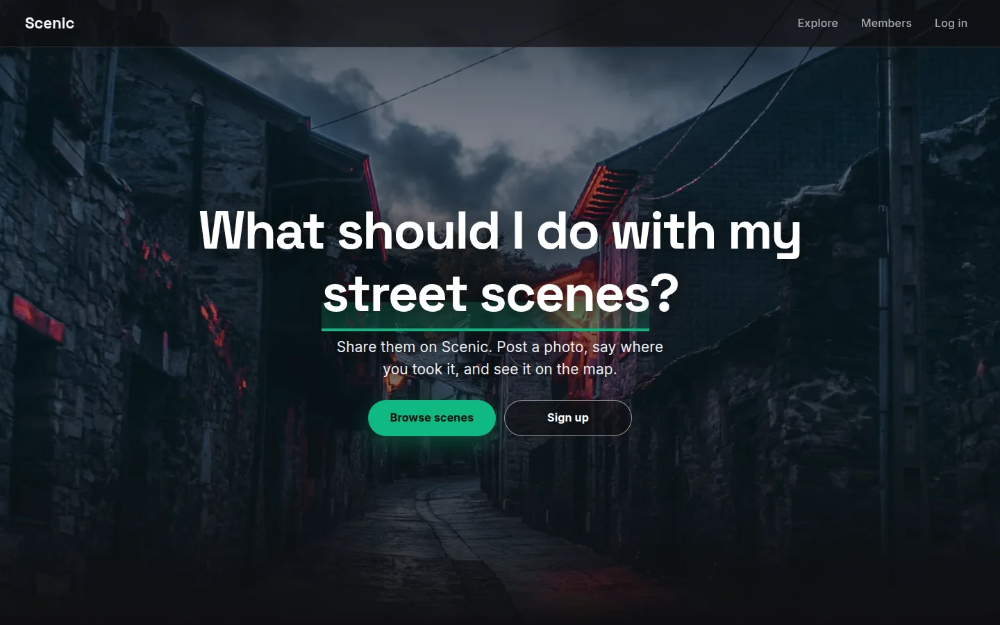
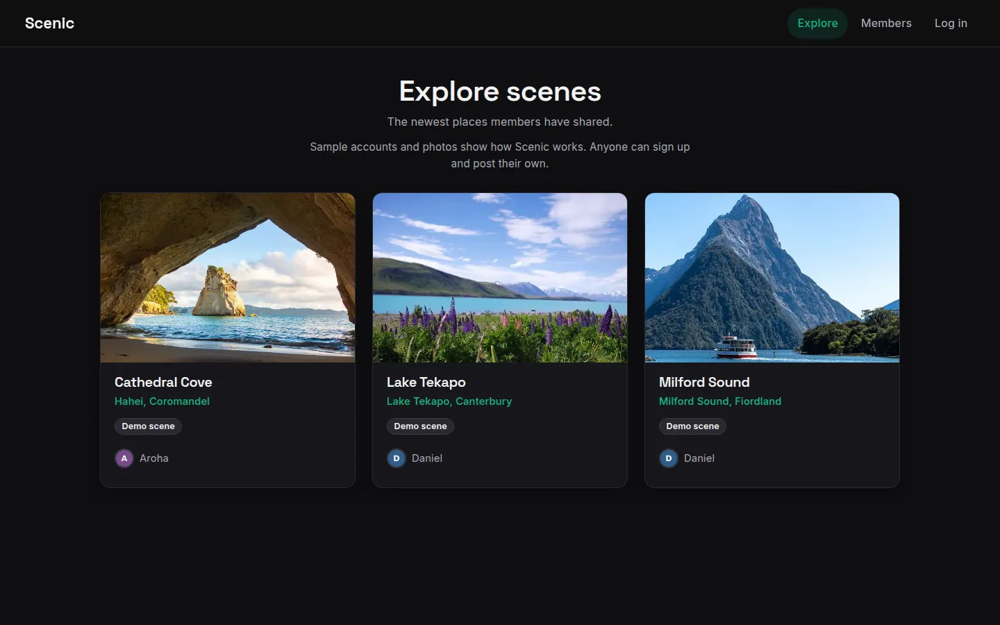
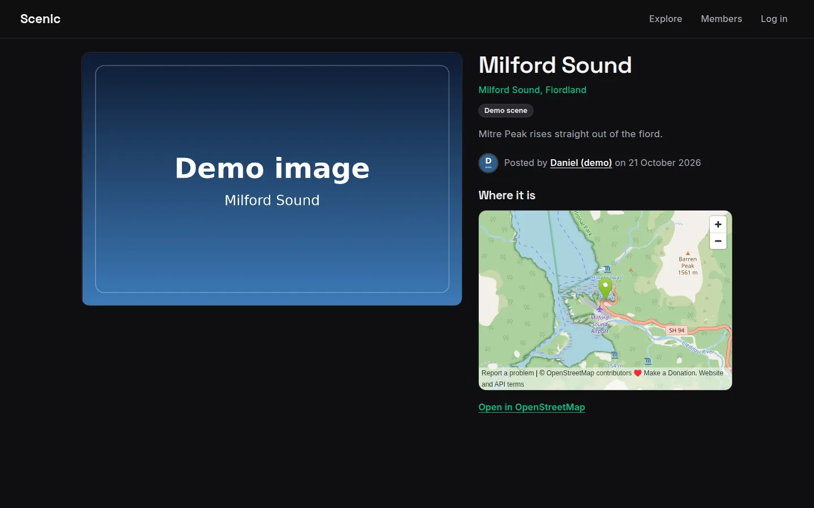
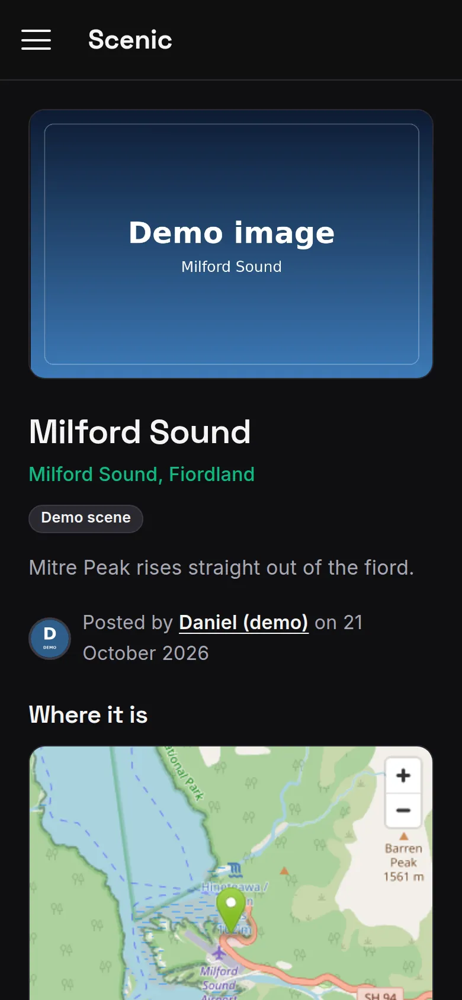

# Scenic

A full-stack MERN image-sharing app: create an account, post photos of places you love with their location, and browse what other members have shared.

- **Live app:** https://scenic-app.vercel.app
- **API:** https://scenic-api.vercel.app



Scenic is my own project: first built in November 2021, moved to serverless hosting on Vercel in June 2026, and modernised in October 2026 (see [What changed in October 2026](#what-changed-in-october-2026)).

| Explore                                                                                                                                                                                                                                                  | A scene page                                                                                                                                                                                                                                         | On a phone                                                                                                                                                             |
| -------------------------------------------------------------------------------------------------------------------------------------------------------------------------------------------------------------------------------------------------------- | ---------------------------------------------------------------------------------------------------------------------------------------------------------------------------------------------------------------------------------------------------- | ---------------------------------------------------------------------------------------------------------------------------------------------------------------------- |
|  |  |  |

The screenshots are of a local build with the repo's built-in demo content: two labelled demo members and three scenes with free-to-use photos from Pexels, credited on each scene page. The live app shows what is in its own database.

## Features

- **Accounts:** sign up with a name, email and password (6 or more characters); a profile photo is optional, and members without one are shown by their initial. Passwords are hashed with bcrypt and logins return a JSON Web Token that expires after one hour. The client keeps the session in `localStorage`. When a session ends (the API stops accepting the token, or it expires on a members-only page), the member is sent to log in with a note saying why, and comes back to the page they were on.
- **Browse:** the landing page shows the six newest scenes, Explore lists every member's scenes twelve at a time ("Load more scenes"), Members lists everyone, and each member has a page of their scenes.
- **Scene pages:** every scene has its own shareable page with the photo, the place, who posted it and when, and an OpenStreetMap embed with a link to the full map.
- **Posting:** signed-in members add a scene with a title, description, location and a JPEG, PNG or WebP photo. The browser prepares the photo before it is uploaded (see [How images are stored and served](#how-images-are-stored-and-served)), so a large phone photo uploads without resizing it first.
- **Edit and delete:** owners can edit a scene's title and description or delete it (after a confirmation that names the scene). The API checks ownership before any change.
- **Maps:** the location you type is turned into coordinates (Google Geocoding API when `GOOGLE_API_KEY` is set, otherwise Nominatim with Photon as a fallback).
- **Demo mode:** if no database is configured or it cannot be reached, read requests are answered from a built-in set of two demo members and three New Zealand scenes, through the same serialisers as database responses, and sign-up, login and other writes return a 503 with an explanation.
- **Demo content is labelled:** sample accounts and scenes (in demo mode, and when seeded into a database) carry `isDemo: true`, show "Demo account" or "Demo scene" in the app, and lists that contain them say so in one line. The built-in demo photos are free-to-use Pexels photos, each credited to its photographer.
- **Accessibility checks:** axe (WCAG 2.2 AA rules) finds no serious or critical issues on any page at phone and desktop widths; keyboard-only journeys, 320 px width and reduced motion are tested too (see [Tests](#tests)). Dialogs and the phone menu are native modal `<dialog>`s.
- **Edge caching:** GET responses send `Cache-Control: s-maxage=1, stale-while-revalidate=599`, so the CDN can answer reads from cache while it refreshes in the background, which hides serverless cold starts.

## Tech stack

- **Client (`ScenicFront/`):** React 19, React Router 7, Vite 8, self-hosted Inter and Space Grotesk
- **API (`ScenicBack/`):** Node.js 24, Express 5, Mongoose 9, multer, express-validator, bcryptjs, jsonwebtoken, helmet, cors, express-rate-limit
- **Tests:** Vitest, supertest and an in-memory MongoDB replica set (API); Vitest and Testing Library (client); Playwright and axe-core end to end; GitHub Actions workflow in `.github/workflows/ci.yml`
- **Database:** MongoDB (MongoDB Atlas in the live deployment)
- **Hosting:** both apps on Vercel; the API runs as a serverless function through `api/index.js` and the rewrite in `vercel.json`

The client's JavaScript is capped at 110 KB gzipped by `npm run test:perf`. React 19 and React Router 7 are larger than React 18 and React Router 6; the trade buys the current, supported majors.

## API

| Method | Path                         | Auth         | Purpose                                                                                                                                                                     |
| ------ | ---------------------------- | ------------ | --------------------------------------------------------------------------------------------------------------------------------------------------------------------------- |
| GET    | `/`                          |              | Health check: `mode` is `"db"` when MongoDB is connected, `"demo"` otherwise                                                                                                |
| GET    | `/api/scenes`                |              | The feed, newest first: `?limit=` (1 to 24, default 12), `?before=<sceneId>` (the `nextCursor` of the previous page), `?creator=<userId>`. Returns `{ scenes, nextCursor }` |
| GET    | `/api/scenes/:sceneId`       |              | One scene with its creator                                                                                                                                                  |
| GET    | `/api/scenes/:sceneId/image` |              | The scene's photo as an image; `?size=card` serves its card-size copy, or the photo when it has none                                                                        |
| GET    | `/api/users`                 |              | Every member, by name, with their scene count                                                                                                                               |
| GET    | `/api/users/:userId`         |              | One member's public profile                                                                                                                                                 |
| GET    | `/api/users/:userId/image`   |              | The member's avatar as an image (404 when they have none)                                                                                                                   |
| POST   | `/api/users/signup`          |              | Create an account (multipart: `name`, `email`, `password`, optional `image`); returns `userId` and `token`                                                                  |
| POST   | `/api/users/login`           |              | Log in with `email` and `password`; returns `userId` and `token`                                                                                                            |
| POST   | `/api/scenes`                | Bearer token | Create a scene (multipart: `title`, `description`, `address`, `image`, optional `thumb`); returns the new scene                                                             |
| PATCH  | `/api/scenes/:sceneId`       | Bearer token | Update `title` and `description` (owner only); returns the scene                                                                                                            |
| DELETE | `/api/scenes/:sceneId`       | Bearer token | Delete a scene (owner only)                                                                                                                                                 |
| GET    | `/api/users/users`           |              | Deprecated: members with inline avatars, kept for the old client                                                                                                            |
| GET    | `/api/scenes/user/:userId`   |              | Deprecated: a member's scenes with inline images, kept for the old client                                                                                                   |

Scenes and members in responses never include an email address, a password hash or image bytes: images are referenced by `imageUrl`, `cardImageUrl` and `avatarUrl`, paths on the API such as `/api/scenes/<id>/image?v=<version>`.

**Status codes.** Every error is JSON with a `message` and `Cache-Control: no-store`; nothing internal (stack traces, database errors) is ever sent.

| Status   | When                                                                                                                                                                       |
| -------- | -------------------------------------------------------------------------------------------------------------------------------------------------------------------------- |
| 200, 201 | Success; 201 for sign-up and a new scene                                                                                                                                   |
| 304      | A conditional GET (`If-None-Match`) for something that hasn't changed                                                                                                      |
| 400      | Malformed JSON                                                                                                                                                             |
| 401      | No token, an invalid or expired token, or an email and password that don't match (the same message whether the email exists or not)                                        |
| 403      | Changing someone else's scene                                                                                                                                              |
| 404      | An unknown route, or an id that doesn't exist or isn't a valid id                                                                                                          |
| 413      | A photo over 3 MB, a card image over 300 KB or a JSON body over 100 KB                                                                                                     |
| 422      | Input that fails validation (the message names the field), an email already in use, a file that isn't a JPEG, PNG or WebP by its bytes, or a place the geocoder can't find |
| 429      | More than 10 sign-up or login attempts from one address in 15 minutes                                                                                                      |
| 500      | Anything unexpected: a generic message; details go to the server log                                                                                                       |
| 502      | The geocoder couldn't be reached                                                                                                                                           |
| 503      | Sign-up, login or any other write in demo mode, or when `JWT_KEY` isn't set                                                                                                |

### How images are stored and served

- **Stored** as base64 inside the scene or user document in MongoDB, so an upload never touches the server's filesystem (Vercel's is read-only) and there is no separate file store to run.
- **Served** as real images from `/api/scenes/:id/image` and `/api/users/:id/image`, never inline in JSON. A list of scenes is a few kilobytes, and browsers can lazy-load, size and cache each photo. The type comes from the stored bytes (JPEG, PNG or WebP; anything else is not served), with a strong ETag, a year of browser caching and a day at the CDN. The URL carries a version: when the document last changed, or for the built-in demo content a hash of the image bytes, so a new photo always gets a new URL.
- **Card-size copies:** scene cards load `cardImageUrl` (`?size=card`), a copy of the photo at most 640 px on the long edge that the browser makes with the upload and sends as `thumb` (300 KB at most). A scene without one (posted by an older client or a script) serves the full photo at that URL.
- **Prepared in the browser** before upload: checked (JPEG, PNG or WebP), turned upright, scaled to at most 1600 px on the long edge and re-encoded as WebP (JPEG where the browser can't encode WebP), aiming for 600 KB. The API still caps uploads at 3 MB and checks the bytes.
- **No hidden location data:** every photo is re-encoded, even a small one, which drops its EXIF metadata, GPS position included. Where a scene is comes only from the Location the member types.

## Design decisions and trade-offs

- **Images in MongoDB, served by URL.** Keeping photos as base64 in the documents needs no file store or extra service, and it suits Vercel's read-only filesystem. The costs are a bigger database and a 16 MB document limit, so uploads are capped at 3 MB and the browser shrinks photos first. The image endpoints keep the bytes out of every JSON response: the old list endpoints sent them inline (hundreds of kilobytes of JSON for one member's scenes), while a page of ten scenes is now a few kilobytes (`npm run test:perf` caps it at 20 KB).
- **A deleted photo can linger at the edge for up to a day.** The CDN keeps an image for a day (`CDN-Cache-Control: max-age=86400`) so popular photos are cheap to serve. Once a scene is deleted nothing links to its image any more, and the URL stops resolving when the CDN copy expires.
- **Demo mode instead of an error page.** When Atlas is unreachable or not configured, visitors still see a working app with two clearly labelled demo members and three scenes. Writes answer 503 instead of pretending to succeed. Demo content is marked in code (`isDemo`, from a `demo` flag or the reserved `@scenic.example` domain), so live rows don't have to be edited and the email never leaves the API.
- **Edge caching, and `?fresh=` after a change.** Reads are cached at the CDN and refreshed in the background (`stale-while-revalidate=599`). That hides cold starts but means a list could be up to 10 minutes old. After a member adds, edits or deletes a scene, the client adds `?fresh=<time of the change>` to its reads for 10 minutes, so they never see the list from before their own change. The API ignores the parameter.
- **Keyless geocoding.** Nominatim (with an identifying User-Agent) and then Photon turn the Location into coordinates, so the app needs no paid API key. A Google key is used when one is set. A place nobody can find is a 422 with an example of what to type; a provider outage is a 502.
- **Per-instance rate limits.** Sign-up and login allow 10 attempts per address every 15 minutes, counted in memory. Each Vercel instance keeps its own count, so the limit slows password guessing rather than capping it exactly; a shared store (such as Redis) would make it exact, at the cost of another service.
- **Old endpoints kept through the switch-over.** The API and the client are separate Vercel projects, and one push to `main` builds both in no fixed order. So the API still answers `/api/users/users` and `/api/scenes/user/:userId` in their old shape (without private fields) for a client built before this change; they can go once the new client is live. `ScenicBack/test/compat-old-front.test.mjs` holds every expectation of the old client.

## Running it locally

Needs Node.js 24 (`.nvmrc` in each package).

### Environment variables

API (`ScenicBack/.env`; copy `ScenicBack/.env.example`):

| Variable          | Needed                  | What it does                                                                                                                   |
| ----------------- | ----------------------- | ------------------------------------------------------------------------------------------------------------------------------ |
| `DB_URL`          | For real data           | MongoDB connection string. Without it the API runs in read-only demo mode.                                                     |
| `JWT_KEY`         | For accounts and writes | Secret used to sign and verify tokens. Without it, reads work and sign-up, login and writes answer 503.                        |
| `GOOGLE_API_KEY`  | No                      | When set, Google geocodes addresses; otherwise Nominatim and Photon do.                                                        |
| `PORT`            | No                      | Port to listen on locally; defaults to `5000`.                                                                                 |
| `CORS_ORIGIN`     | No                      | Comma-separated browser origins allowed to call the API, for example `https://scenic-app.vercel.app`. Unset allows any origin. |
| `SEED_PASSWORD`   | No                      | Only read by the seeding script: the password for the seeded demo accounts.                                                    |
| `MONGOMS_VERSION` | No (tests only)         | The MongoDB version the tests run; defaults to `8.2.6`.                                                                        |

Client (`ScenicFront/.env.local`; copy `ScenicFront/.env.example`):

| Variable                | Needed | What it does                                                                                                                                                                                                                                                                           |
| ----------------------- | ------ | -------------------------------------------------------------------------------------------------------------------------------------------------------------------------------------------------------------------------------------------------------------------------------------- |
| `REACT_APP_BACKEND_URL` | No     | The API base URL including `/api`, for example `http://localhost:5000/api`. The name is kept from the Create React App days so existing deployments keep working. Unset, production builds use `https://scenic-api.vercel.app/api` and `npm run dev` uses `http://localhost:5000/api`. |
| `VITE_SITE_URL`         | No     | The client's public address, used only for the absolute share-image URLs in `index.html`; defaults to `https://scenic-app.vercel.app`.                                                                                                                                                 |

### Database note

Creating and deleting scenes uses MongoDB transactions, which need a replica set. MongoDB Atlas works as is. A plain standalone local `mongod` will serve reads, sign-up, login and scene edits, but scene create and delete will fail unless it runs as a replica set.

### Start the API

```bash
cd ScenicBack
npm install
cp .env.example .env   # fill in DB_URL and JWT_KEY
npm start              # http://localhost:5000
```

To try it without a database, skip the `.env`: `npm start` then serves the demo content read-only.

To copy the demo users and scenes into a real database, run the seeding script from `ScenicBack`. It does not read `.env`, so pass the variables in the shell:

```bash
DB_URL=<connection-string> node util/seedAtlas.js
```

It skips users and scenes that already exist and flags what it creates as demo content. If `SEED_PASSWORD` is not set, it generates a password for the accounts it creates and prints it.

### Start the client

```bash
cd ScenicFront
npm install
npm run dev       # http://localhost:5173, talks to http://localhost:5000/api
npm run build     # production build in build/ (hashed assets in build/static/)
npm run preview   # serve that build locally
```

## Tests

Every suite runs on this machine only: an in-memory MongoDB that the tests start themselves, no real database, and a guard that fails any request to another host.

First run on a new machine: `MONGOMS_RUNTIME_DOWNLOAD=true npm test` in `ScenicBack` downloads the MongoDB binary, and every suite then uses the cached copy. Without it, a missing binary fails the run instead of downloading mid-test. CI downloads it.

| Command                                | Where         | What it runs                                                                                                                                                                                                                                                                                                                                                                                                                                                                                                                                          |
| -------------------------------------- | ------------- | ----------------------------------------------------------------------------------------------------------------------------------------------------------------------------------------------------------------------------------------------------------------------------------------------------------------------------------------------------------------------------------------------------------------------------------------------------------------------------------------------------------------------------------------------------- |
| `npm test`                             | `ScenicBack`  | API tests: Vitest and supertest against the real app on an in-memory MongoDB replica set. Accounts, tokens, scenes and their transactions, ownership, uploads, the feed, images, the old endpoints, privacy, caching, CORS, rate limits, errors, geocoding, demo mode and the seeding script.                                                                                                                                                                                                                                                         |
| `npm run test:coverage`                | `ScenicBack`  | The same, with a coverage report in `coverage/`; fails under 85% of lines.                                                                                                                                                                                                                                                                                                                                                                                                                                                                            |
| `npm test`                             | `ScenicFront` | Client tests: Vitest and Testing Library in jsdom, every page against a fake API, plus hooks, forms, dialogs and the photo preparation.                                                                                                                                                                                                                                                                                                                                                                                                               |
| `npm run test:coverage`                | `ScenicFront` | The same, with a coverage report; fails under 70% of lines.                                                                                                                                                                                                                                                                                                                                                                                                                                                                                           |
| `npm run test:e2e`                     | `ScenicFront` | End to end: Playwright drives a production build against the real API and seeded demo data. The main journeys (browse; sign up, post a 6 MB photo, edit, delete; log in after a wrong password; a session that runs out), every route's states, dialogs, forms, the hero, and the accessibility gates: axe (WCAG 2.2 AA, no serious or critical findings) on every page and every form's error state at 390 and 1440 px and on each dialog while it is open, no sideways scroll at 320 px, 44 px tap targets, keyboard-only journeys, reduced motion. |
| `npm run test:perf`                    | `ScenicFront` | Budgets on a throttled phone connection: landing page 800 KB or less in the first 10 s at 390 px (1.2 MB at 1440), no hero or demo image over 250 KB, no hero photo off the landing page, layout shift 0.02 or less on the landing page and 0.001 or less elsewhere, 10 scenes of feed JSON in 20 KB or less, all JavaScript 110 KB or less gzipped. Kept apart from `test:e2e` because timings vary with machine load; don't run the two at once (both build into `build/`).                                                                         |
| `npm run lint`, `npm run format:check` | both          | ESLint and Prettier.                                                                                                                                                                                                                                                                                                                                                                                                                                                                                                                                  |

Before the end-to-end or performance runs, run `npm ci` in `ScenicBack` too: they start the API from there. Locally they launch Chrome from `/usr/bin/google-chrome` (Linux). Elsewhere, run `npx playwright install chromium` and set `CI=1` to use Playwright's Chromium.

Ports (the end-to-end and performance ones can be changed):

| Port             | Used by                                | Variable                                             |
| ---------------- | -------------------------------------- | ---------------------------------------------------- |
| 7103, 7107, 7109 | API tests (app, MongoDB, a second app) | fixed                                                |
| 7104, 7105, 7108 | `test:e2e` (client, API, MongoDB)      | `PW_PREVIEW_PORT`, `PW_API_PORT`, `PW_DB_PORT`       |
| 7106, 7102, 7109 | `test:perf` (client, API, MongoDB)     | `PERF_PREVIEW_PORT`, `PERF_API_PORT`, `PERF_DB_PORT` |

**CI.** `.github/workflows/ci.yml` is set up to run lint, format, the coverage runs, the build and the end-to-end tests on Node 24 for every push and pull request. It hasn't run on GitHub yet, so run the suites locally.

## Deploying

Both apps are Vercel projects linked to this GitHub repository: the API with Root Directory `ScenicBack`, the client with Root Directory `ScenicFront`. A push to `main` deploys both.

- **API:** one serverless function (`api/index.js`, with the rewrite in `vercel.json`). Set `DB_URL` and `JWT_KEY` in the project; `CORS_ORIGIN` and `GOOGLE_API_KEY` are optional.
- **Client:** a Vite build into `build/` (`vercel.json`). `REACT_APP_BACKEND_URL` is optional; without it the build uses `https://scenic-api.vercel.app/api`.
- **Order:** the API has to be live before or together with the client. One push builds both in no fixed order, so the API keeps answering an older client (see [Design decisions](#design-decisions-and-trade-offs)). If the client goes live first, pages that need new API routes show an error until the API deployment finishes.

## Hero photos

The landing page's four photos are served as AVIF (and one WebP fallback per crop), in a wide 16:10 crop for landscape screens and a tall 9:16 crop for phones, each file under 200 KB. Only the first photo loads with the page; the other three wait for the load event and never load when the visitor prefers reduced motion. The four full-size originals (about 11 MB together) used to sit in `ScenicFront/public/assets/` and were all preloaded on every page. They are no longer in the working tree but stay in git history (for example `git show a92484bb:ScenicFront/public/assets/Street.jpg`), and `ScenicFront/scripts/hero/build-hero.mjs` reads them from there:

```bash
cd ScenicFront/scripts/hero && npm ci && node build-hero.mjs
```

## Project structure

```
.github/workflows/  CI for both packages
ScenicBack/
  app.js            createApp(): security headers, CORS, rate limits, cache headers, demo-mode gate, routes, errors
  api/index.js      Vercel serverless entry point
  Routes/           users, scenes and demo-mode routers
  controllers/      request handlers
  models/           Mongoose User and Scene schemas, HttpError
  middleware/       JWT check, MongoDB connection, uploads, validation, error responses
  util/             serialisers, image type detection and serving, email rules, geocoding, demo data, seeding script
  assets/demo/      demo scene photos, their 640 px card copies (*-card.webp) and avatars
  scripts/          make-demo-images.py, which builds assets/demo/; run by hand
  test/             API tests (Vitest + supertest + in-memory MongoDB)
ScenicFront/
  index.html        Vite entry
  vercel.json       build settings, SPA rewrite and asset caching for Vercel
  public/           favicon, web app manifest, robots.txt and the link-preview image
  src/config.js     API base URL
  src/landing_page/ landing page: rotating hero photos and the newest scenes
  src/assets/hero/  the hero photos as AVIF and WebP (made by scripts/hero/build-hero.mjs)
  scripts/hero/     re-encodes the hero photos; has its own package.json (sharp), run by hand
  scripts/og/       draws public/og-image.png, run by hand
  src/user/         sign-up, login and the members list
  src/scenes/       Explore, scene page, member pages, add and edit forms, the feed hook
  src/shared/       HTTP client, route guards, form elements, modals, map, avatar, auth context and hooks
  src/**/*.test.*   client tests next to the code they test
  e2e/              Playwright tests against a local API and an in-memory database (e2e/perf: budgets)
docs/               README screenshots
```

## What changed in October 2026

- **Repository:** about 45,600 committed `node_modules` files and the old build output are no longer tracked (history is unchanged); both packages have ESLint and Prettier.
- **API:** Express 5, Mongoose 9 and current majors on Node 24. Requests that used to crash the process or leak errors get the right status and a plain JSON message, login is hardened (uniform answers, no operator injection, rate limits, HS256-only tokens), and member emails never leave the API.
- **Images:** served from their own URLs instead of inline base64 in JSON, and resized and re-encoded in the browser before upload.
- **New pages and API routes:** Explore (a paged feed), public scene pages with a map, public member pages, a members list with scene counts, Page not found, and a title for every page.
- **Client:** moved from Create React App 3 (React 17, React Router 5) to Vite 8, React 19 and React Router 7, with one HTTP client for errors and ended sessions.
- **Design and accessibility:** the landing page no longer preloads 11 MB of photos, its slideshow has a pause control, and its heading is a plain question. The update also brought native `<dialog>`s, a skip link and landmarks, colours that pass contrast, form errors linked to their fields, loading skeletons with one Try again on errors, self-hosted fonts with size-matched fallbacks, and plain NZ English copy.
- **Honest demo content:** demo members and scenes are labelled, and every built-in demo photo is credited.
- **Tests and CI:** the suites in [Tests](#tests), and a GitHub Actions workflow that hasn't run on GitHub yet.

## What's next

- Remove the deprecated endpoints and response fields once the new client is live.
- Get the GitHub Actions workflow running on GitHub.
- A shared store for the sign-up and login rate limit, if it ever needs to be exact.

## Author

Built by Daniel Olliver. More of my work: [danielolliver.com/dev](https://danielolliver.com/dev/).

I also run [Olliver Web](https://olliverweb.co.nz), my web design and development business in Auckland.
